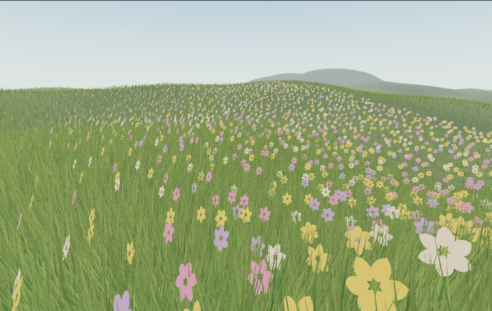
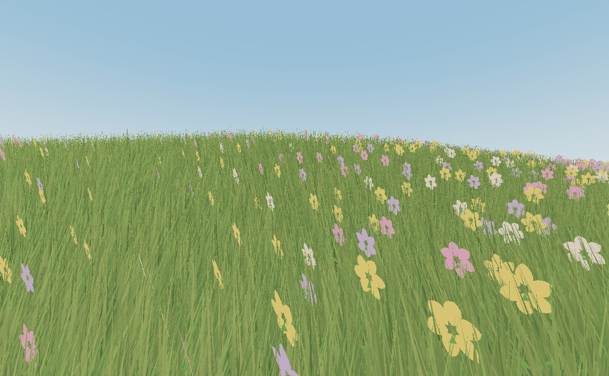

# Vulkan Meadow

Исследуйте цветочную лужайку с холмистым рельефом, высокой травой и дальними горами. Мир генерируется процедурно, а управлять прогулкой можно от первого лица.

# Запустить проект
К сожедению вы не можете просто запустить exe, вам самим придется собрать build, вы можете это сделать через любую нейросеть вроде Copilot внутри VS CODE, дайте нейронке задачу: У меня не открыается VulkanMeadow\build\Release\VulkanMeadow.exe, собери новый build, если на пк не установлены какие-либо из требуемых компонентов, установи их, в конце запусти проект. Поставьте для нейросети в permission (обычно эта кнопка в самым низу чата с ИИ), Allow All, чтобы не подтверждать каждое действие вручную.

.\VulkanMeadow\build\Release\VulkanMeadow.exe 

Открой папку VulkanMeadow -> build -> Releaseв Проводнике и дважды щёлкни VulkanMeadow.exe.

## Управление

- **W / A / S / D** — движение
- **Shift** — бег
- **Space** — прыжок
- **Мышь** — обзор
- **F** — оконный / полноэкранный режим
- **Esc** — выход

Технические требования, сборка и структура исходников: [README_TECHNICAL.md](README_TECHNICAL.md).
